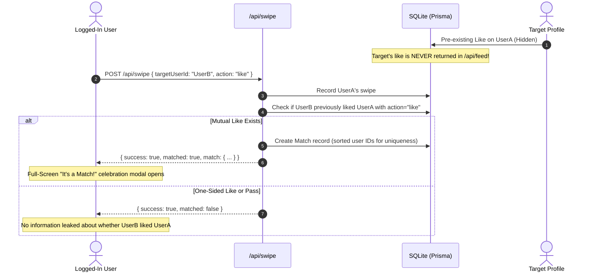
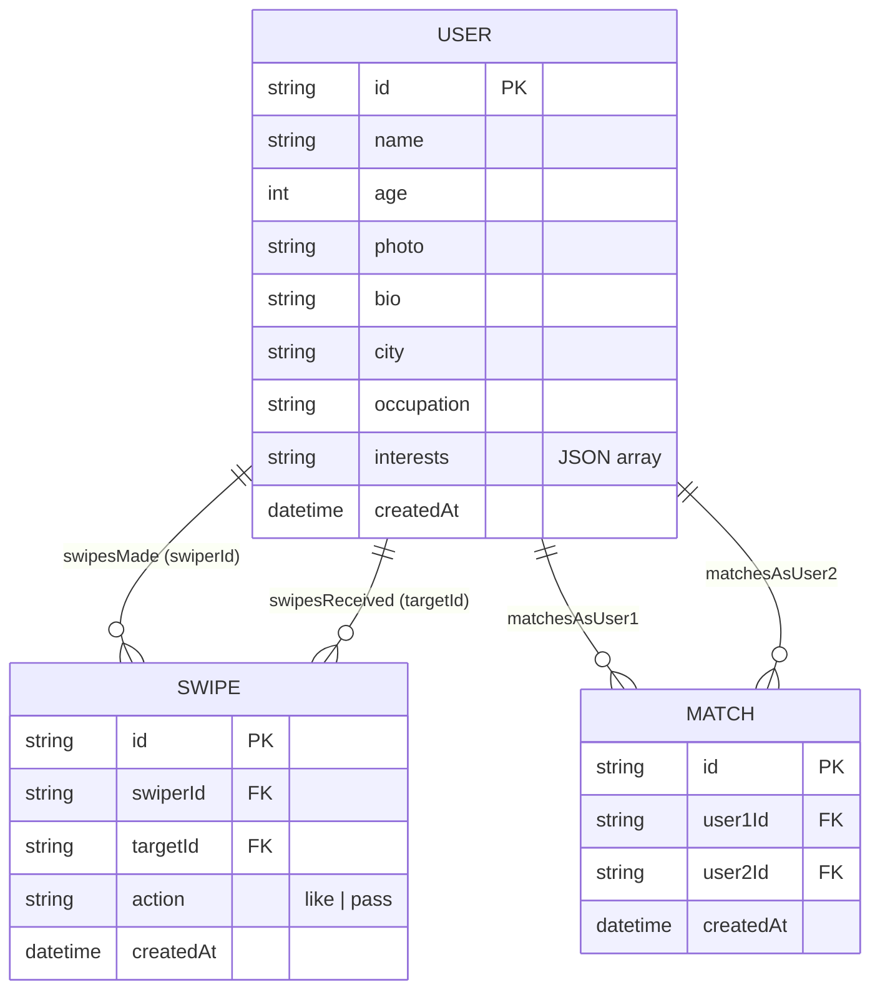

# 🌹 Coy Discover — Full-Stack SDE Intern Assignment

> A modern, mobile-first dating discovery application built with **Next.js 15 (App Router)**, **TypeScript**, **Tailwind CSS**, **Framer Motion**, **Prisma ORM**, and **SQLite**. Features double-blind mutual matching, zero-leakage privacy guarantees, AI compatibility scoring & icebreakers, drag-and-swipe physics, celebration modals, and automated tests.

---

## 📋 Table of Contents
1. [Part A: Core Feature Proposals for Coy](#part-a-coy-product-evaluation--core-feature-proposals)
2. [Part B: Coy Discover Overview](#part-b-coy-discover-overview)
3. [✨ Key Features](#-key-features)
4. [🤖 AI Features](#-ai-features)
5. [🔒 Privacy & Double-Blind Matching Guarantee](#-privacy--double-blind-matching-guarantee)
6. [🏗️ Architecture & Tech Stack](#️-architecture--tech-stack)
7. [📂 Project Folder Structure](#-project-folder-structure)
8. [🗄️ Database Schema & Prisma Models](#️-database-schema--prisma-models)
9. [📡 API Specification & Examples](#-api-specification--examples)
10. [🧪 Automated Test Suite](#-automated-test-suite)
11. [🚀 Quickstart & Setup Guide](#-quickstart--setup-guide)
12. [🐙 Git Commands to Publish to GitHub](#-git-commands-to-publish-to-github)
13. [🚢 Deployment Guide](#-deployment-guide)

---

## Part A: Coy Product Evaluation & Core Feature Proposals

After reviewing the Coy product flow (Phone OTP login, Adding a crush, Email verification, Invite link loops, and the extra-slots monetization screen), here are two high-impact core feature proposals:

### 1. Verified Campus & Community Circles ("Coy Rings")
- **Problem**: In a pure contact-book or open-directory crush app, user hesitation is high because people don't know who else is active on Coy. Crushes often fail to match simply because the target hasn't heard of the app.
- **Proposed Feature**: Allow users to verify their college or company email (e.g., `@iitb.ac.in`, `@bits-pilani.ac.in`, `@google.com`). Within verified Circles, users can see anonymized aggregate metrics (e.g., *"48 crushes added in IIT Bombay this week"*).
- **Why Required**: Dating applications thrive on network density. Knowing that one's immediate peer group is active drastically lowers psychological friction, incentivizes adding real crushes, and fuels viral organic word-of-mouth invitations without compromising confidentiality.

### 2. Double-Blind "Warm-Up Hint" Push Notifications
- **Problem**: When a user adds 1 or 2 crushes and doesn't get an immediate match, retention drops sharply. They may assume the app is dead or inactive.
- **Proposed Feature**: Zero-knowledge aggregate notifications sent to the crush target: *"Someone from your 2024 college cohort listed you as a crush! Add your crushes to see if it's mutual."*
- **Why Required**: This triggers immense curiosity while strictly keeping the sender's identity hidden. It acts as an organic re-engagement engine, prompting the recipient to sign up and submit their own list, unlocking mutual matches that would otherwise stay dormant.

---

## Part B: Coy Discover Overview

**Coy Discover** brings the swipe-discovery experience into the Coy ecosystem:
- **Mobile-first interface** with warm white/cream neutral backgrounds (`#fdfbf7`), crisp typography, and coral/pink accents (`#ff4136`).
- **Smooth gesture physics**: Drag cards left to pass, right to like, with real-time rotation, dynamic LIKE/NOPE stamps, and spring transitions powered by Framer Motion.
- **Desktop click controls & keyboard support**: Arrow keys (`→` Like, `←` Pass) and touch-friendly circular buttons.
- **Zero-knowledge matching**: Incoming likes are NEVER exposed. Only mutual likes produce a match.
- **Persistent storage**: SQLite database using Prisma ORM. Swipes, matches, and user profiles persist across refreshes and restarts.

---

## ✨ Key Features

- 📱 **Mobile-First Responsive Layout**: Optimized for mobile viewports with an app shell, floating bottom navigation, and desktop-friendly centering.
- 🎴 **Fluid Card Stack**: Drag gestures, rubber-band resistance, smooth exit animations, and visual LIKE/NOPE feedback.
- 🎉 **Full-Screen Match Celebration**: Confetti particle burst, side-by-side profile avatars with heart badge, celebration messaging, and navigation to Matches.
- 🖼️ **Robust Image Resilience**: Graceful loading skeletons and fallback avatar initials if an image fails to load.
- 🚫 **Duplicate & Self-Swipe Protection**: Backend unique constraints (`swiperId_targetId` and `user1Id_user2Id`) and transactional safety prevent race conditions.
- 🔍 **Empty State Handling**: "You've explored everyone for now!" screen with one-tap link to Matches and refresh capabilities.

---

## 🤖 AI Features

### 1. AI Vibe Check & Compatibility Match Algorithm (`generateAIInsight`)
Each profile card features an interactive **AI Vibe Check** pill:
- Calculates a dynamic compatibility percentage based on shared interests and profile lifestyle attributes.
- Highlights common ground with visual tags (e.g., `✨ music`, `✨ travel`).

### 2. Contextual AI Icebreaker Suggestions
To eliminate awkward first messages:
- Contextual conversation starters generated specifically to bridge common interests.
- Displayed directly on Discover cards and accessible in the **Matches tab** by tapping any match card.

---

## 🔒 Privacy & Double-Blind Matching Guarantee

The core promise of Coy is **privacy without compromise**:



### Backend Privacy Rules:
1. **`GET /api/feed`**: Queries only profiles where `id NOT IN (swipedIds + currentUserId)`. Incoming likes are completely decoupled and excluded from the query response.
2. **`POST /api/swipe`**: If the target user has not liked back, the response is `{ success: true, matched: false }`. No clue is given regarding the target's swipe status.
3. **`GET /api/matches`**: Returns only records from the `Match` table where both users have reciprocated likes.

---

## 🏗️ Architecture & Tech Stack

| Layer | Technology | Purpose |
|---|---|---|
| **Frontend Framework** | Next.js 15 (App Router) | Server and Client Components, fast routing |
| **Language** | TypeScript 5.7 | Strict type safety across frontend and API |
| **Styling** | Tailwind CSS 3.4 | Mobile-first utilities, coral/cream design system |
| **Animation** | Framer Motion 11 | Drag gestures, card tilt physics, modal animations |
| **Icons** | Lucide React | Clean, consistent icons |
| **ORM** | Prisma 5.22 | Type-safe queries, migrations, relationships |
| **Database** | SQLite (`file:./prisma/dev.db`) | Zero-config persistent relational database |
| **Testing** | Vitest 2.1 + Testing Library | Fast unit and integration tests |

---

## 📂 Project Folder Structure

```text
coy-discover/
├── prisma/
│   ├── dev.db                 # Persistent SQLite database
│   ├── schema.prisma          # Database schema (User, Swipe, Match)
│   └── seed.ts                # Seeds 36 realistic profiles + 6 pre-seeded likes
├── src/
│   ├── app/
│   │   ├── api/
│   │   │   ├── feed/route.ts      # GET /api/feed
│   │   │   ├── matches/route.ts   # GET /api/matches
│   │   │   └── swipe/route.ts     # POST /api/swipe
│   │   ├── discover/page.tsx      # Swipe discovery interface
│   │   ├── matches/page.tsx       # Mutual matches grid with AI icebreakers
│   │   ├── globals.css            # Tailwind layers and custom styling
│   │   ├── layout.tsx             # Root layout with metadata
│   │   └── page.tsx               # Home tab with Coy welcome & Part A proposals
│   ├── components/
│   │   ├── discover/
│   │   │   ├── AIInsightBadge.tsx # AI compatibility badge & icebreaker drawer
│   │   │   └── ProfileCard.tsx    # Drag-and-swipe card with tilt & stamps
│   │   ├── AppShell.tsx           # Mobile-first viewport container
│   │   ├── BottomNav.tsx          # 3-tab floating navigation bar
│   │   ├── EmptyState.tsx         # "You've explored everyone for now!"
│   │   ├── MatchModal.tsx         # Full-screen celebration modal with confetti
│   │   └── SwipeButtons.tsx       # Bottom circular Pass / Like action buttons
│   ├── hooks/
│   │   ├── useFeed.ts             # Feed state management hook
│   │   ├── useMatches.ts          # Matches state management hook
│   │   └── useSwipe.ts            # Swipe action & duplicate protection hook
│   ├── lib/
│   │   ├── ai-utils.ts            # AI scoring & icebreaker generator
│   │   ├── constants.ts           # Shared constants (CURRENT_USER_ID, ACTIONS)
│   │   └── prisma.ts              # Singleton Prisma client instance
│   ├── tests/
│   │   ├── api.test.ts            # 13 comprehensive API & DB integration tests
│   │   └── setup.ts               # Vitest environment setup
│   └── types/
│       └── index.ts               # Shared TypeScript interfaces
├── package.json
├── tailwind.config.ts
├── tsconfig.json
└── vitest.config.ts
```

---

## 🗄️ Database Schema & Prisma Models



---

## 📡 API Specification & Examples

### 1. `GET /api/feed`
Retrieves discovery profiles excluding the logged-in user and any profile already swiped on.

**Request:**
```http
GET /api/feed HTTP/1.1
```

**Response (`200 OK`):**
```json
{
  "profiles": [
    {
      "id": "user-ananya",
      "name": "Ananya Sharma",
      "age": 22,
      "photo": "https://i.pravatar.cc/400?img=1",
      "bio": "IIT Delhi grad who codes by day and paints by night 🎨",
      "city": "Delhi",
      "occupation": "Frontend Developer",
      "interests": ["coding", "art", "music", "travel"]
    }
  ]
}
```

---

### 2. `POST /api/swipe`
Records a swipe (`like` or `pass`). Performs transactional reciprocal matching.

**Request Body:**
```json
{
  "targetUserId": "user-ananya",
  "action": "like"
}
```

**Response (`200 OK` — Mutual Match Occurred):**
```json
{
  "success": true,
  "matched": true,
  "match": {
    "id": "cm3abc123000008l41234abcd",
    "user": {
      "id": "user-ananya",
      "name": "Ananya Sharma",
      "photo": "https://i.pravatar.cc/400?img=1"
    }
  }
}
```

**Response (`200 OK` — No Match / One-Sided / Passed):**
```json
{
  "success": true,
  "matched": false
}
```

---

### 3. `GET /api/matches`
Returns all verified mutual matches for the logged-in user.

**Response (`200 OK`):**
```json
{
  "matches": [
    {
      "id": "match-cuid-1",
      "matchedUser": {
        "id": "user-ananya",
        "name": "Ananya Sharma",
        "age": 22,
        "photo": "https://i.pravatar.cc/400?img=1",
        "bio": "IIT Delhi grad who codes by day and paints by night 🎨",
        "city": "Delhi",
        "occupation": "Frontend Developer",
        "interests": ["coding", "art", "music", "travel"]
      },
      "createdAt": "2026-11-17T18:30:00.000Z"
    }
  ]
}
```

---

## 🧪 Automated Test Suite

Run all tests with:
```bash
npm test
```

### Verified Test Cases (13 Passing):
- ✔️ **Feed Privacy**: Excludes current user from discovery.
- ✔️ **Feed Privacy**: Excludes previously swiped profiles.
- ✔️ **Feed Privacy**: Never exposes incoming likes (zero-knowledge guarantee).
- ✔️ **Swipe Logic**: Like creates a valid persistent swipe record.
- ✔️ **Swipe Logic**: Pass creates a valid persistent swipe record.
- ✔️ **Matching Logic**: One-sided like does not create a match.
- ✔️ **Matching Logic**: Passing never creates a match even if the other user liked.
- ✔️ **Matching Logic**: Mutual likes create a match.
- ✔️ **Safety**: Duplicate swipes are rejected safely via unique constraints.
- ✔️ **Safety**: Users cannot match with or swipe on themselves.
- ✔️ **Matches Endpoint**: Returns only mutual matches.
- ✔️ **Persistence**: Swipes persist after reload.
- ✔️ **Persistence**: Matches persist after reload.

---

## 🚀 Quickstart & Setup Guide

### Prerequisites
- Node.js 18+ (tested on Node 24)
- npm 9+

### 1. Install Dependencies
```bash
npm install --legacy-peer-deps
```

### 2. Setup Database & Seed 36 Profiles
```bash
npm run setup
```
*(This generates the Prisma client, pushes the SQLite schema, and seeds 36 realistic Indian student/young professional profiles with 6 pre-seeded mutual likes for live demo).*

### 3. Start Development Server
```bash
npm run dev
```
Open **[http://localhost:3000](http://localhost:3000)** in your browser or toggle mobile emulation in Chrome DevTools (`Cmd + Shift + M`).

---

## 🐙 Git Commands to Publish to GitHub

To push this repository to your public GitHub account:

```bash
# Initialize git if not already initialized
git init

# Add all files
git add .

# Commit changes
git commit -m "feat: complete Coy Discover full-stack dating discovery app"

# Add your GitHub repository remote
git remote add origin https://github.com/<YOUR-USERNAME>/coy-discover.git

# Set default branch to main and push
git branch -M main
git push -u origin main
```

---

## 🚢 Deployment Guide

### Deploying to Vercel
1. Push your repository to GitHub.
2. Go to [vercel.com](https://vercel.com) and click **"Add New Project"**.
3. Import your `coy-discover` repository.
4. Set Build Command: `npm run setup && npm run build`
5. Click **Deploy**.

*(Note: SQLite works in local or single-container environments. For production serverless deployments with global scaling, switch the `provider` in `prisma/schema.prisma` from `sqlite` to `postgresql` or `mysql` using Neon, Supabase, or PlanetScale).*

---

## 📄 License
MIT © 2026 Coy SDE Intern Assignment Implementation.
